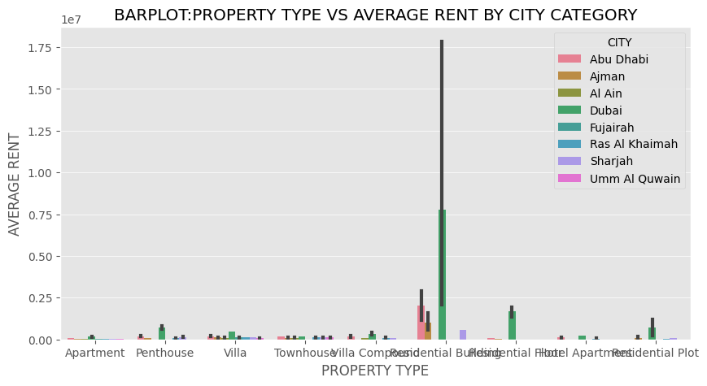

# UAE Rental Market Analysis

## About the Project

This project focuses on analysing the UAE rental property market to understand how rental prices vary across different cities, locations and property types.

Using Python, I explored a real-world UAE rental property dataset containing approximately 73,742 records and worked through 27 analytical questions. The analysis covers rental prices, property sizes, rent per square foot, bedrooms, bathrooms, furnishing status and property types.

The main objective was to explore the dataset, identify meaningful patterns and understand rental market trends through Exploratory Data Analysis (EDA) and data visualisations.

## Dataset Information

- **Dataset:** UAE Rental Property Data
- **Total Records:** Approximately 73,742
- **Total Columns:** 17
- **Domain:** Real Estate / Rental Market
- **Analysis Type:** Exploratory Data Analysis (EDA)

## Tools & Technologies

- Python
- Pandas
- Matplotlib
- Seaborn

## Data Cleaning & Preparation

Before performing the analysis, I carried out the following data preparation steps:

- Loaded the dataset using Pandas.
- Inspected the first and last records.
- Checked missing values across all columns.
- Standardised column names by removing extra spaces and replacing underscores.
- Removed duplicate records.
- Converted relevant columns into appropriate numeric data types.
- Examined the dataset structure and statistical summary.

## Exploratory Data Analysis (27 Questions)

I explored different aspects of the UAE rental property market through 27 analytical questions.

### 1. Rental Price Analysis

1. Compared average rental prices across cities and identified the highest and lowest.
2. Analysed average rent across different property types.
3. Compared average rental prices across different locations.
4. Identified cities with the minimum and maximum individual rent per square foot.
5. Compared average rent per square foot across cities.
6. Identified property types with the minimum and maximum individual rent per square foot.
7. Analysed average rent per square foot across property types.
8. Identified locations with the minimum and maximum individual rent per square foot.
9. Compared average rent per square foot across locations.

### 2. Property Area Analysis

10. Identified cities with the smallest and largest individual property areas.
11. Compared average property areas across cities.
12. Identified property types with the smallest and largest individual property areas.
13. Analysed average property areas across property types.
14. Identified locations with the smallest and largest individual property areas.
15. Compared average property areas across locations.

### 3. Property Features & Market Trends

16. Analysed average rent based on bedrooms and rent categories.
17. Compared city-wise average rent across rent categories.
18. Studied bathroom-wise average rent based on furnishing status.
19. Created a correlation heatmap for numerical variables.
20. Compared average property area across cities based on furnishing status.
21. Analysed city-wise average rent per square foot across rent categories.
22. Examined property type counts across different cities.
23. Compared average rent by property type across cities.
24. Analysed city-wise average rent based on furnishing status.
25. Identified the top 5 most expensive cities based on average rent.
26. Identified the top 5 cheapest building types based on average rent.
27. Identified the top 5 most expensive locations based on average rent.

## Project Visualisations & Analysis

### 1. Bathroom-wise Average Rent

This chart compares average rental prices based on the number of bathrooms. It helps understand how rental prices vary with bathroom availability.

### 2. Bedroom-wise Average Rent

This visualisation shows average rental prices based on the number of bedrooms and different rent categories.

### 3. City-wise Area by Furnishing

This chart compares average property areas across cities based on furnishing status. It helps examine differences in property sizes between furnished and unfurnished listings.

### 4. City-wise Average Rent

This chart compares average rental prices across cities and helps identify differences in rental costs between locations.

### 5. City-wise Property Type Count

This visualisation shows the distribution of different property types across cities. It helps understand which property types appear more frequently in the dataset.

### 6. City-wise Rent by Furnishing

This chart compares average rental prices across cities according to furnishing status. It helps explore how furnishing is associated with rental prices.

### 7. City-wise Rent per Sqft by Rent Category

This visualisation compares average rent per square foot across cities and rent categories, providing another perspective on rental price differences.

### 8. Correlation Heatmap

The correlation heatmap displays relationships between numerical variables such as bedrooms, bathrooms, property area, rent and rent per square foot. It helps identify positive and negative correlations between these variables.

### 9. Property Type-wise Average Rent

This chart compares average rental prices across different property types and helps understand how rental costs vary by property category.

## Key Learnings

Through this project, I gained practical experience in:

- Working with a real-world UAE real estate dataset.
- Cleaning and preparing data using Pandas.
- Applying GroupBy, aggregation and sorting operations.
- Performing Exploratory Data Analysis (EDA).
- Comparing rental prices and property features.
- Creating visualisations using Matplotlib and Seaborn.
- Identifying patterns and trends through data analysis.
- Presenting analytical findings in a structured manner.

## Conclusion

This project provided practical experience in analysing UAE rental property data and exploring factors associated with rental prices across different cities, locations and property types.

By working through 27 analytical questions, I explored rental prices, rent per square foot, property sizes, furnishing categories and property features.

The project helped strengthen my Python, Pandas and data visualisation skills while improving my understanding of real-world data analysis and the Exploratory Data Analysis process.
