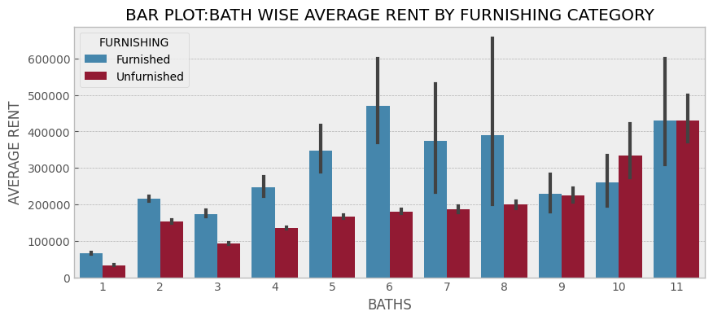
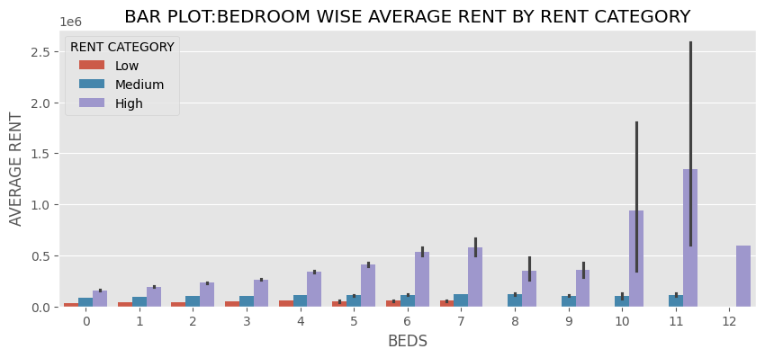
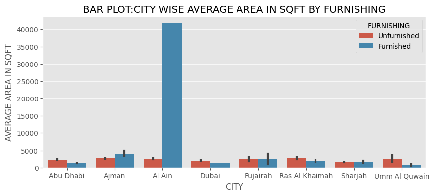
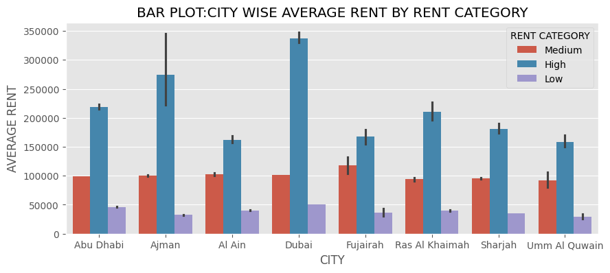
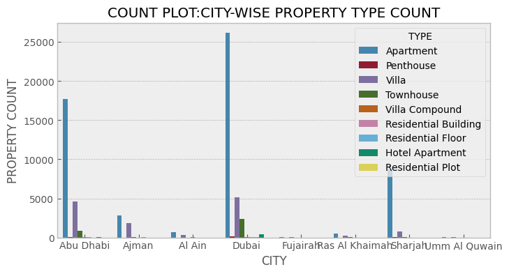
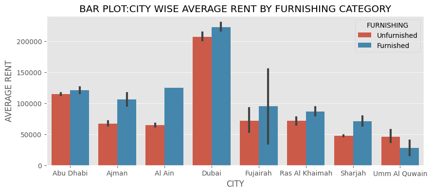
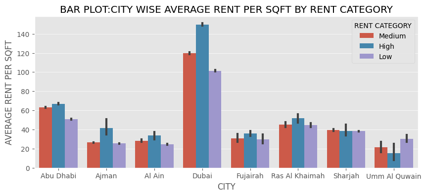
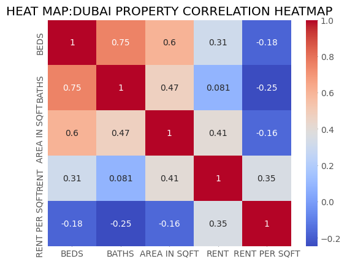

# UAE Rental Market Analysis

## About the Project

This project focuses on analysing the UAE rental property market to understand how rental prices vary across different cities, locations and property types.

Using Python, I explored a real-world UAE rental property dataset containing approximately 73,742 records and worked through 27 analytical questions. The analysis covers rental prices, property sizes, rent per square foot, bedrooms, bathrooms, furnishing status and property types.

The main objective was to explore the dataset, identify meaningful patterns and understand rental market trends through Exploratory Data Analysis (EDA) and data visualisations.

## Dataset Information

- **Dataset:** UAE Rental Property Data
- **Total Records:** Approximately 73,742
- **Total Columns:** 17
- **Domain:** Real Estate / Rental Market
- **Analysis Type:** Exploratory Data Analysis (EDA)

## Tools & Technologies

- Python
- Pandas
- Matplotlib
- Seaborn

## Data Cleaning & Preparation

Before performing the analysis, I carried out the following data preparation steps:

- Loaded the dataset using Pandas.
- Inspected the first and last records.
- Checked missing values across all columns.
- Standardised column names by removing extra spaces and replacing underscores.
- Removed duplicate records.
- Converted relevant columns into appropriate numeric data types.
- Examined the dataset structure and statistical summary.

## Exploratory Data Analysis (27 Questions)

I explored different aspects of the UAE rental property market through 27 analytical questions.

### 1. Rental Price Analysis

1. Compared average rental prices across cities to identify the top cheapest and most expensive hubs.
2. Analysed average rent across different property types to evaluate building segment values.
3. Compared average rental prices across different macro locations to isolate high-value sectors.
4. Identified cities with the minimum and maximum individual rent per square foot listings.
5. Compared average rent per square foot parameters across major cities.
6. Identified property types commanding the minimum and maximum individual rent per square foot values.
7. Analysed average rent per square foot performance across property types.
8. Identified specific locations with the minimum and maximum individual rent per square foot entries.
9. Compared average rent per square foot layouts across municipal locations.

### 2. Property Area Analysis

10. Identified cities hosting the smallest and largest individual property areas in SqFt.
11. Compared average property area dimensions across different cities.
12. Identified property types featuring the smallest and largest individual property areas in SqFt.
13. Analysed average property areas across structural property types.
14. Identified locations with the smallest and largest individual property areas in SqFt.

### 3. Location-wise Property Dimension Spreads

15. Isolated the dataset to rank the top 5 locations commanding the absolute smallest average property areas in SqFt.
16. Evaluated macro parameters to rank the top 5 locations hosting the largest average property areas in SqFt.

### 4. Property Features & Market Trends

17. Analysed average rent based on bedroom counts grouped by active rent categories.
18. Compared city-wise average rent variables across different rent categories.
19. Studied bathroom-wise average rent metrics based on active furnishing statuses.
20. Created a multi-variable correlation heatmap for numerical attributes (Beds, Baths, Rent, Area).
21. Compared average property area footprints across cities based on furnishing status.
22. Analysed city-wise average rent per square foot parameters across rent categories.
23. Examined property count distributions across different municipal cities.
24. Analysed city-wise average rent spreads based on structural furnishing status.
25. Identified the top 5 most expensive cities based on average macro rental pricing.
26. Identified the top 5 cheapest property building types based on mean rental outlays.
27. Identified the top 5 most expensive operational locations based on average rental records.

## Project Visualisations & Analysis

### 1. Bathroom-wise Average Rent

This chart compares average rental prices based on the number of bathrooms. It helps understand how rental prices vary with bathroom availability.

### 2. Bedroom-wise Average Rent

This visualisation shows average rental prices based on the number of bedrooms and different rent categories.

### 3. City-wise Area by Furnishing

This chart compares average property areas across cities based on furnishing status. It helps examine differences in property sizes between furnished and unfurnished listings.

### 4. City-wise Average Rent

This chart compares average rental prices across cities and helps identify differences in rental costs between locations.

### 5. City-wise Property Type Count

This visualisation shows the distribution of different property types across cities with optimized axis margins. It helps understand which property types appear more frequently in the dataset.

### 6. City-wise Rent by Furnishing

This chart compares average rental prices across cities according to furnishing status. It helps explore how furnishing is associated with rental prices.

### 7. City-wise Rent per Sqft by Rent Category

This visualisation compares average rent per square foot across cities and rent categories, providing another perspective on rental price differences.

### 8. Correlation Heatmap

The correlation heatmap displays relationships between numerical variables such as bedrooms, bathrooms, property area, rent and rent per square foot. It helps identify positive and negative correlations between these variables.

## Key Learnings

Through this project, I gained practical experience in:

- Working with a real-world UAE real estate dataset.
- Cleaning and preparing data using Pandas.
- Applying GroupBy, aggregation and sorting operations.
- Performing Exploratory Data Analysis (EDA).
- Comparing rental prices and property features.
- Creating visualisations using Matplotlib and Seaborn.
- Identifying patterns and trends through data analysis.
- Presenting analytical findings in a structured manner.

## Conclusion

This project provided practical experience in analysing UAE rental property data and exploring factors associated with rental prices across different cities, locations and property types.

By working through 27 analytical questions, I explored rental prices, rent per square foot, property sizes, furnishing categories and property features.

The project helped strengthen my Python, Pandas and data visualisation skills while improving my understanding of real-world data analysis and the Exploratory Data Analysis process.
